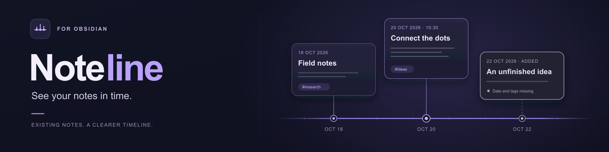

<p align="center">
  
</p>

# Noteline for Obsidian

**English** · [Русский](README-ru.md)

## Why Noteline

A project, a research journal, or a collection of ideas often makes more sense in chronological order. Noteline places your existing Obsidian notes on timelines so you can see when things happened and read the notes in context.

Create independent `.timeline` files, select notes from any folder, and open different timelines in separate tabs. Each file keeps its own selected notes, layout, date settings, and view. Your notes stay ordinary Markdown files in their original locations.

**Documentation is available in English and Russian. The interface in version 0.3.0 is Russian.** English guides include the actual Russian control labels. Translating the documentation does not add an interface language switch.

## Who it's for

Noteline is useful whenever the order of milestones, events, or log entries matters:

| Audience | Example timelines |
| --- | --- |
| Teachers | Lesson topics, course milestones, and events discussed with students |
| Developers | Releases, incidents, technical decisions, and development logs |
| Managers | Project milestones, meetings, decisions, and progress journals |
| Historians | Historical events, archival notes, years, and centuries, including BCE |

Use a dated Markdown note for each milestone, event, or log entry, then group related notes in a dedicated `.timeline` file. A note can appear on several timelines while keeping one source text.

## What you can do

- Add existing Markdown notes from anywhere in your vault, including folders with identical filenames.
- Keep several file-backed timelines and open them in separate tabs.
- Read dates from note properties or a leading `📅` line, with minute, day, month, year, or century precision, including BCE years and centuries.
- Collapse cards to their title, date, and tags, or expand them to read native Obsidian Markdown.
- Choose a horizontal or vertical time axis, reverse its chronological direction, and arrange cards without changing their dates.
- Zoom, pan, fit the selected notes, and jump to a date or today.
- See missing metadata immediately: notes without a date or tags have a gray frame and a text explanation.
- Add a tag explicitly to the original note; adding or moving a card does not rewrite the note.
- Save timeline membership and layout in vault `.timeline` files, with light and dark themes and touch-friendly action buttons.
- Use a thin time axis with ringed note markers, fine card borders, rounded tags, and a subtle gradient background inspired by the banner.

If a note has no date, Noteline uses the local date when you add it and saves that fallback. The card stays on that day instead of moving with “today.” If only tags are missing, the note keeps its original date. [Date and tag rules](docs/en/dates-and-tags.md).

## Quick start

**Obsidian 1.7.2 or newer.** Version 0.3.0 passed native macOS smoke checks with Obsidian 1.14.4. The plugin uses browser-compatible APIs and enables mobile installation. Physical iOS/Android, Windows/Linux, Obsidian 1.7.2 itself, touch gestures, and actual sync transport/provider conflicts remain unverified.

1. [Install a built copy](docs/en/installation.md) in a test vault. A source checkout alone is not an installed plugin. Community directory installation requires review and acceptance by Obsidian.
2. Open the command palette and run **Noteline: Открыть временную ось** — Open timeline.
3. Create a `.timeline` file if this is your first timeline, or select an existing one. Commands **Noteline: Создать временную ось** and **Noteline: Выбрать временную ось** create and select timelines. Different files can stay open in separate tabs.
4. Choose **Добавить заметку** — Add note — and select a note by name or path. The file context menu and active-note command also let you choose the destination timeline.
5. Expand a card with its expand button. Use the title to open the original note for editing. Choose the time-axis orientation and direction in the toolbar.
6. Use **−/+** to zoom and **Показать все** — Show all — to fit the selected dates. The toolbar also provides timeline selection, creation, deletion, saving a copy, and reloading from disk.

[Continue the quick start](docs/en/quick-start.md).

## Note formats

Use existing properties or a small metadata block at the beginning of the note:

```yaml
---
timeline-date: "2026-10-22 15:30"
tags:
  - research
  - ideas/audio
---
```

```markdown
📅 2026-10-22 15:30
📍 Tags: #research #ideas/audio

---

Your note content.
```

The default date priority is `timeline-date`, then `date`, then the leading `📅` line. Property names and their order are configurable per timeline. Supported values also include `2026-10`, numeric YAML years such as `date: 2026`, uppercase Roman centuries such as `XIX`, and `44 BC` or `II BC`. Partial values keep their precision and do not display invented days. Dates are calendar values without a time zone. [Supported formats, conflicts, and missing fields](docs/en/dates-and-tags.md).

## Documentation

- [Installation and updates](docs/en/installation.md)
- [Quick start and controls](docs/en/quick-start.md)
- [Timeline files, independent tabs, and file format](docs/en/timeline-files.md)
- [Dates, tags, and gray frames](docs/en/dates-and-tags.md)
- **[Data storage, privacy, backups, and sync](docs/en/data-and-security.md)**
- [Troubleshooting and known limits](docs/en/troubleshooting.md)
- [Development and publication](docs/en/development.md)
- [All user documentation](docs/en/index.md)

## Your notes and your data

Each `.timeline` file stores its selected note paths, fallback dates, layout, date settings, orientation, direction, and viewport. The plugin's `data.json` remembers the last opened path and retains legacy data after migration. Opening, expanding, moving, or removing a card from a timeline does not delete or rewrite its source note. **Adding a tag is an explicit write to that note**, visible in every timeline that uses it.

Back up and synchronize the `.timeline` files **together with** their notes and attachments. Do not assume your sync tool includes this custom extension. Use one active writer per timeline and wait for sync before switching devices; simultaneous layouts are not merged automatically. Existing single-timeline data is migrated to `Noteline.timeline`, with a different available name if necessary, while the old data is retained. [Storage, migration, desktop/iOS sync, and recovery](docs/en/data-and-security.md).

The plugin makes no network requests of its own, collects no telemetry, and needs no account or server. Obsidian's Markdown renderer and other installed plugins may load external content referenced in a note.

## Development

Node.js 24+ and npm are development tools; users only need the built plugin files.

```sh
npm ci
npm run check
npm run build
```

The production build creates `main.js`. Install it alongside `manifest.json` and `styles.css`; do not copy `node_modules` into a vault. GitHub release assets use these three files individually, with a tag matching `manifest.version`. [Build and publication guide](docs/en/development.md).

## Scope of version 0.3.0

Multiple independent timeline files, one card per note within each timeline, horizontal or vertical axes, and either chronological direction. A copy of a timeline keeps references to the same notes; it does not duplicate their contents. There are no event intervals, date editing by dragging, image export, collaborative conflict merging, or pinch-to-zoom. Files renamed while the plugin is disabled may need manual relinking. [Compatibility and limitations](docs/en/troubleshooting.md).

Licensed under [MIT](LICENSE). The original banner artwork is provided under [CC0 1.0](docs/artwork.md).
